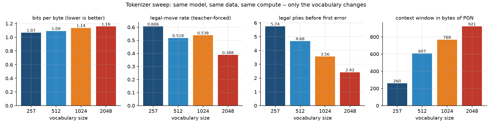
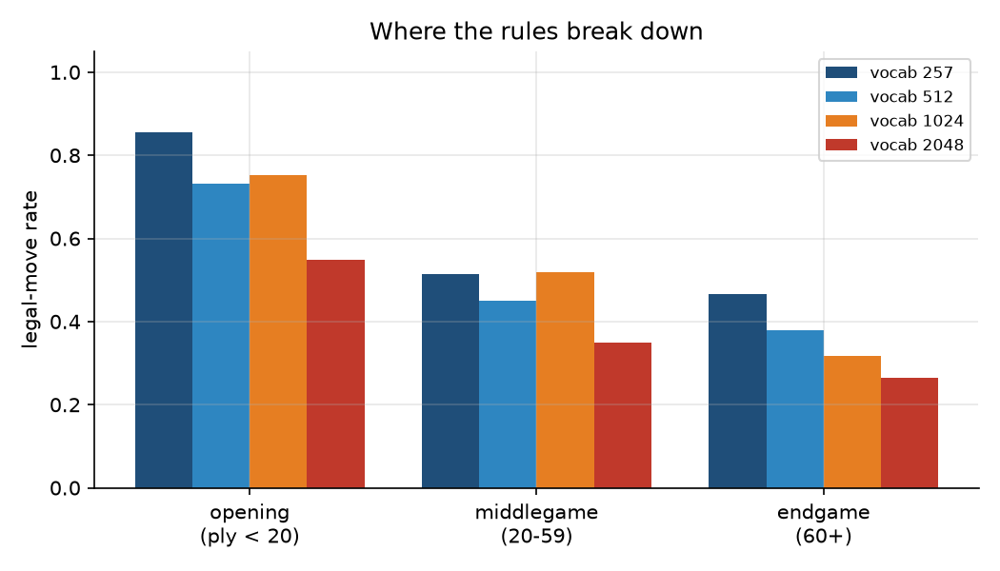
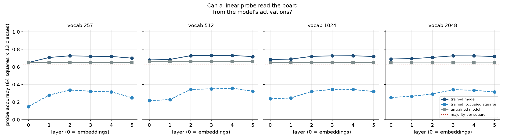
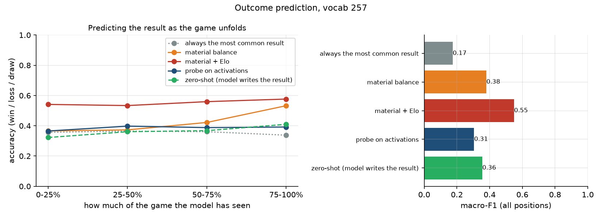

# Chess as a Language: what a from-scratch transformer learns from grandmaster games

A 344K–459K-parameter transformer that has never been told the rules of chess, trained on
72,885 grandmaster games written as plain text — built as a tested Python package, a reproducible
Colab sweep, an interactive Streamlit app, and a technical report (`report/main.tex`).




---

## What this is

The model, tokenizer, loss, and training utilities are the ones I wrote from scratch for UCSC
CSE 142 (a decoder-only transformer trained on TinyStories). Not one line of the model changed.
Only the data did: instead of children's stories, it reads games like

```
1.e4 e5 2.Nf3 Nc6 3.Bb5 a6 4.Ba4 Nf6 5.O-O Be7 ... 1-0
```

and predicts the next byte. Chess is a useful testbed because, unlike English, there is a
**referee**: python-chess can say with certainty whether any move the model writes is legal.
That turns "the loss went down" into questions with exact answers.

| # | Question | How it is measured |
|:--:|---|---|
| 1 | **Tokenization** — how does the BPE vocabulary size change what the model learns? | Same model, data, and compute at vocab 257 / 512 / 1024 / 2048; compared in **bits per byte** |
| 2 | **Rules** — does a model trained only on move text learn to play legal chess? | Teacher-forced **legal-move rate** on held-out games; **legal plies** before the first error when playing alone |
| 3 | **Board state** — does it track where the pieces are, or only memorise text? | **Linear probe** on each layer's activations reconstructs all 64 squares; compared with an untrained copy of the same network and a per-square majority baseline |
| 4 | **Outcome** — can it tell from the moves who is going to win? | Win / loss / draw from a game prefix: **zero-shot** (the model writes the result) and a **probe on activations**, vs. majority, material, and material + Elo baselines, by fraction of game seen |

Vocab 257 is raw bytes plus the `<|game|>` separator (no merges), so it doubles as the
character-level reference.

---

## Verified

| Claim | Check | Where |
|---|---|---|
| Vectorised BPE is the CSE 142 BPE | identical merges and encodings on 40 random corpora; ~35× faster (2 MB: 3.5 s vs. ~2 min) | `test_tokenizer.py` |
| CSE 142 model files unchanged | `model.py`, `nn_utils.py`, `training_utils.py`, `lr_schedule.py` byte-identical apart from the package name | — |
| Parameter count | `V·d + L(4d² + 3d·d_ff)` exactly, ≤ 500K for every vocab in the sweep | `test_model.py` |
| Causal mask | changing future tokens leaves past logits identical | `test_model.py` |
| Cross-entropy | matches `F.cross_entropy` on logits of magnitude ~30 | `test_model.py` |
| Every training game is legal chess | each game replayed on a board; SAN re-rendered canonically; 26 invalid games dropped | `test_pgn.py` |
| No train/test leakage | 9,191 duplicate games (same game in both players' archives) removed before splitting by game | `test_end_to_end.py` |
| Evaluation is correct | an oracle model that knows the true game scores 100% legal, 100% exact, at every ply | `test_legality.py` |
| Probes are aligned to the right move | each move's last token is located by byte offset, so features are read exactly after move *k*; board labels checked against hand-computed positions | `test_probes.py` |
| Probe fitting works | recovers a planted linear rule; material balance matches hand-computed captures | `test_probes.py` |
| Attention read-out does not change the model | recording the softmax weights leaves logits bit-identical; weights are causal and sum to 1, also at move level when tokens span two moves | `test_attention.py` |
| Exported app models are exact | weights reloaded from `models/` give identical logits | `test_scripts.py` |

## Results

All four runs share one config (d_model 64, 5 layers, 4 heads, context 256 tokens, 5,000 steps,
batch 32) and took about 5 minutes each on a Colab T4. Only the tokenizer changes.

| Vocab | Params | Bytes / token | Context (bytes) | Val bits / byte ↓ | Legal-move rate ↑ | Exact match ↑ | Legal plies alone ↑ |
|---:|---:|---:|---:|---:|---:|---:|---:|
| **257** (bytes) | 344K | 1.01 | 260 | **1.067** | **0.606** | **0.206** | **5.74** |
| 512 | 360K | 2.37 | 607 | 1.092 | 0.518 | 0.150 | 4.68 |
| 1024 | 393K | 3.00 | 768 | 1.135 | 0.538 | 0.126 | 3.56 |
| 2048 | 459K | 3.60 | 921 | 1.158 | 0.388 | 0.108 | 2.42 |

**1. Tokenization: at this scale, bigger vocabularies hurt.** Byte-level wins on every metric even
though BPE lets the 2048 model see 3.5× more text per window and per training step. With
d_model 64, the larger embedding tables take capacity from the transformer, and many BPE merges
straddle move boundaries (`"8 1"`, `"6.N"`, `".Rd1 R"`), so a single move is split differently
depending on its neighbours.

**2. Rules: partly learned, and they degrade with game length.** The byte model plays a legal
next move 61% of the time on held-out games (86% in the opening, 51% in the middlegame, 47% in
the endgame) and about 6 legal moves in a row on its own after a 10-ply prompt.



**3. Board state: a weak but real internal board.** A linear probe reads the 64 squares from layer
2–4 activations at 0.73 accuracy, against 0.65 for an untrained copy of the same network and
0.63 for always guessing each square's most common contents. The gap is clearest on occupied
squares: 0.34–0.36 for the trained model vs. 0.08–0.14 untrained and 0.03 majority. The signal
peaks in the middle layers and falls off in the last one, consistent with the final layer
specialising in next-token prediction.



**4. Outcome: the model does not know who is winning.** Material balance plus Elo difference
reaches 0.55 accuracy (macro-F1 0.55); material alone 0.43; a probe on the model's activations
0.39–0.40, barely above the 0.36 majority baseline. Zero-shot scoring ("which result does the
model write next?") is at chance for the byte model and collapses to always predicting `1-0` for
every BPE model: mid-game, each result is so unlikely that the comparison is decided by
tokenization (`1-0` is 2 BPE tokens, `0-1` and `1/2-1/2` are 3), not by the position. This is a
limitation of zero-shot scoring a small model out of distribution, and is reported as measured.



---

## Three engineering decisions worth pointing at

**Losses are compared in bits per byte, not per token.** A 2048-token vocabulary packs ~3.6×
more text into each token than raw bytes do, so its per-token loss is larger even when the model
is better. Every run is converted with `bpb = (nats/token) / (bytes/token) / ln 2` using the
measured bytes-per-token of the validation split.

**Prompts use token healing.** BPE learns merges that straddle move boundaries (`"5 "`, `".N"`).
Encoding a prompt like `1.e4 e5 2.` on its own can therefore produce a token sequence the model
never saw in training, which makes a correct model look illegal. The sampler drops the last
prompt token and constrains the first generated tokens to reproduce its bytes, letting the model
choose its own tokenisation across the boundary. The oracle test is what proves this works.

**Data is replayed, not trusted.** Raw PGN from different sources disagrees on spacing,
annotations, and comments. Every game is played out move by move on a real board and its
movetext regenerated from the legal moves, so the model sees one canonical format and every
training example is guaranteed legal.

---

## Run it

```bash
git clone https://github.com/moon-silence/chess-transformer.git
cd chess-transformer
pip install -e ".[dev]"
pytest                                   # 103 tests

bash scripts/download_data.sh            # 19 grandmaster archives from pgnmentor.com
python scripts/prepare_data.py           # validate, dedupe, split, train 4 tokenizers (~15 min)
python scripts/run_sweep.py              # train + evaluate each vocab (GPU recommended)
python scripts/run_probes.py --vocab 512  # board + outcome probes for one run
python scripts/make_figures.py
python scripts/export_models.py          # copy weights into models/ for the app
streamlit run app/streamlit_app.py
```

The full sweep is meant for a GPU: open
[`notebooks/colab_sweep.ipynb`](notebooks/colab_sweep.ipynb) in Colab, select a T4 runtime, and
run all cells. Data and checkpoints persist on Google Drive, and results, figures, and the
exported app models are pushed back to the repo at the end.

## The app

`streamlit run app/streamlit_app.py` opens six tabs:

- **Play it** — play against the model; every model move is marked legal, legal after a retry, or
  illegal (replaced by a random legal move), with its rejected attempts shown.
- **Watch it play** — give it a real opening and let it play both sides until its first illegal move.
- **Inside the model** — the real board next to the board a linear probe reads from the model's
  activations, with wrong squares in red.
- **Attention** — pick a layer and head: arrows show which earlier moves the model looks back at
  while reading a move, next to the full move-by-move attention heatmap.
- **Tokenizer** — the same movetext split into tokens by each vocabulary.
- **Results** — the sweep table and every figure.

## Layout

```
src/chesslm/
  model.py, nn_utils.py,           # from CSE 142, unchanged
  training_utils.py, lr_schedule.py
  _reference_tokenizer.py          # CSE 142 BPE, kept as the ground truth for tests
  tokenizer.py                     # vectorised BPE with identical output
  pgn.py                           # parse, validate, canonicalise games
  data.py                          # dedupe, split by game, tokenize, bytes/token
  train.py                         # training loop with bits-per-byte evaluation
  legality.py                      # token-healing sampler + legal-move metrics
  probes.py                        # residual-stream features, board/outcome probes, zero-shot
  attention.py                     # attention weights per layer/head, token- and move-level
scripts/                           # download, prepare, train, evaluate, sweep, probes,
                                   # figures, export_models
app/streamlit_app.py               # play / watch / inside the model / attention / tokenizer / results
report/main.tex, refs.bib          # technical report (LaTeX + BibTeX)
models/                            # exported weights for the app (after the Colab run)
configs/base.yaml                  # the one config every sweep run shares
notebooks/colab_sweep.ipynb        # full experiment on a Colab GPU
tests/                             # 103 tests
```

## Data

72,885 unique games after validation and de-duplication, from the
[pgnmentor.com player archives](https://www.pgnmentor.com/files.html) of Anand, Aronian,
Capablanca, Carlsen, Caruana, Ding, Firouzja, Fischer, Giri, Grischuk, Karpov, Kasparov,
Kramnik, Nakamura, Nepomniachtchi, Rapport, So, Tal, and Topalov. Split 96 / 2 / 2 by game
(seed 42). At vocab 512 the training split is 15.0M tokens, comparable to the TinyStories subset
the model was designed for.

## License

MIT
